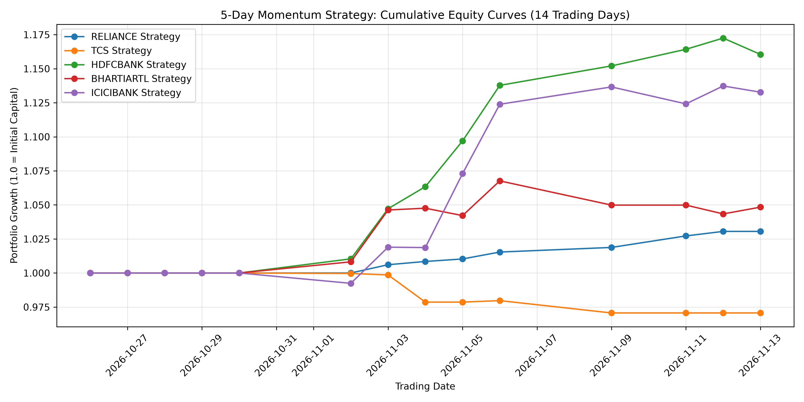

# NSE Top-5 Algorithmic Momentum & Backtesting Engine

A systematic Python backtesting model evaluating a **5-day Simple Moving Average (SMA)** momentum strategy with stop-loss risk controls across 14 trading sessions for the top 5 NSE equities by market capitalization.

## Strategy & Quantitative Logic
- **Momentum Indicator:** Uses a 5-day Simple Moving Average (1 trading week) to filter daily price noise and identify short-term trend direction (`Buy/Hold` when closing price > 5-day SMA; `Cash` otherwise).
- **Look-Ahead Bias Prevention:** Shifts execution signals forward by 1 trading day (`t-1`) so trades execute on the next session rather than the signal's closing price.
- **Downside Risk Control:** Enforces a strict **2% daily stop-loss cap** alongside cash-exit protection during negative momentum regimes.

## Backtest Performance Summary (14 Trading Sessions)

| Ticker | Strategy Return (%) | Buy & Hold Return (%) | Annualized Sharpe Ratio | Max Drawdown (%) |
| :--- | :---: | :---: | :---: | :---: |
| **HDFCBANK** | +16.05% | +16.85% | 11.29 | -1.02% |
| **ICICIBANK** | **+13.28%** | +12.87% | 7.10 | -1.10% |
| **BHARTIARTL** | +4.84% | +9.83% | 3.83 | -2.27% |
| **RELIANCE** | +3.05% | +11.47% | 11.04 | **0.00%** |
| **TCS** | **-2.93%** | -5.03% | -6.57 | -2.93% |

### Key Takeaways
- **Outperformance & Low Drawdown:** Outperformed passive Buy & Hold on **ICICI Bank** (+13.28% vs. +12.87%) with just a -1.10% drawdown, and captured **+3.05%** on **Reliance** with **0.00% peak-to-trough drawdown**.
- **Capital Protection:** Cut losses nearly in half during **TCS's** downturn (-2.93% vs. -5.03%) by exiting to cash once price broke below its 5-day SMA.

## Cumulative Equity Curves

## Tech Stack
- **Language:** Python 3.12
- **Libraries:** `pandas`, `matplotlib`
